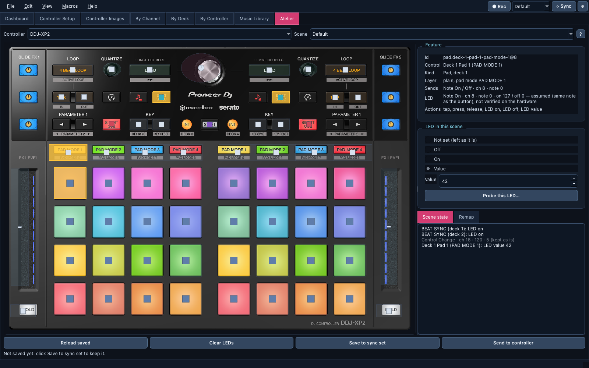
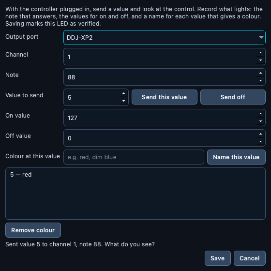
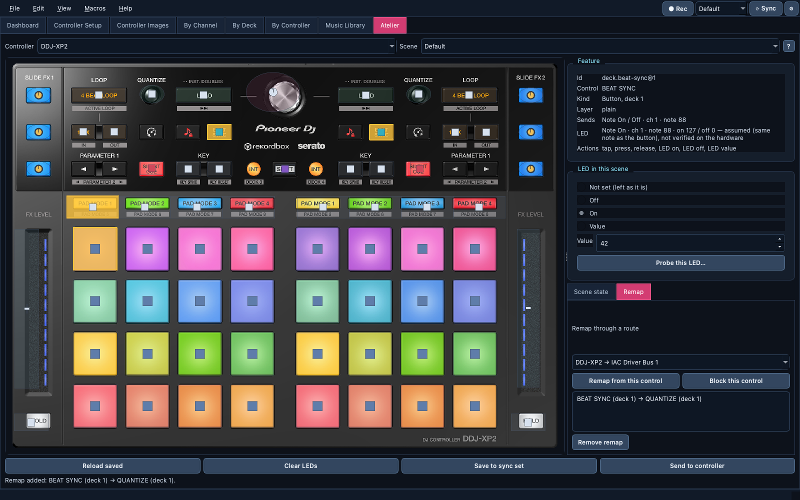

# 🎨 Atelier

> Design what your controller's LEDs show for each sync scene, by clicking
> its controls on its photo — instead of recording or typing MIDI messages.

📍 [Docs](../../README.md) › [End user](../README.md) › [Features](README.md) › Atelier

## Table of Contents

- [What it does](#what-it-does)
- [Design a scene](#design-a-scene)
- [Save, send and reload](#save-send-and-reload)
- [What is kept](#what-is-kept)
- [LED addresses](#led-addresses)
- [Remap a control](#remap-a-control)
- [Related](#related)

## What it does

A [controller sync set](controller-sync.md) is the list of messages the
app sends a controller at launch, when it's plugged in, or when you click
**⟳ Sync**. For its LEDs, what matters is the state those messages leave
the controller in. The **Atelier** tab shows that state on the controller's
photo and lets you change it control by control.

## Design a scene

1. Pick the **Controller** and the **Scene** (the sync scenes you already
   use, and the active one).
2. Click a control on the photo. It works like the
   [Controller Emulator](controller-emulator.md): a pad mode button picks
   the bank the pads use, **SHIFT** stays held until you click it again,
   and the right-hand pads and buttons are deck 2. The **Feature** card
   shows the control you picked.
3. Under **LED in this scene**, choose **Off**, **On**, a **Value** (a
   colour on controllers that have them), or **Not set** to leave that LED
   alone.

Lit controls show on the photo, and **Scene state** lists every LED the
scene sets; click a line to select that control again.

## Save, send and reload

| Button | What it does |
| --- | --- |
| **Save to sync set** | Stores the scene as the controller's sync set for that scene: the next Sync puts the controller in this state |
| **Send to controller** | Sends the scene to the controller now, without saving, to try it |
| **Clear LEDs** | Removes every LED from the scene (other messages stay) |
| **Reload saved** | Drops your changes and reads the saved sync set again |

## What is kept

A sync set may hold messages that aren't LEDs of this controller (a mode
switch, another device's message). The Atelier keeps them, in place, and
lists them as *kept as is*. When a set lights the same LED twice, the scene
keeps the state the controller ends up in (the last value), at the first
message's place.

## LED addresses

Most controller documents don't say which message lights which LED. When
they don't, the app assumes the LED answers on the same note as its button,
which is true for most Serato controllers; the **Feature** card says
*assumed, not verified* until it's been checked on the hardware.

To check it, plug the controller in, select the control and click **Probe
this LED…**:

1. The output port is the controller's own when it's connected.
2. **Send this value** sends the value to the address shown (channel and
   note): look at the control. If nothing lights, try another note.
3. Set the **On value** and **Off value** that work, and for a control
   with colours, send a value, type what you see (`red`, `dim blue`) and
   click **Name this value**; repeat for each colour you want to keep.
4. **Save** records the LED as verified: the Feature card then says
   *verified (LED probe <date>)*, and the Atelier and macros use that
   address and those values.

The results are kept per controller in the workspace's Controllers folder
(`<controller>.leds.json`).

## Remap a control

The Atelier can also make one control act as another, without editing the
DJ software's mapping: messages go through a [MIDI Routing](midi-routing-and-clock.md)
route (from the controller to the DJ software's virtual port), and the
route's remaps rewrite them on the way.

1. Under **Remap through a route**, pick the route (add one in MIDI
   Routing first).
2. Select the control to remap, click **Remap from this control**, then
   click the control it should act as: its presses now leave as that
   control's.
3. Or click **Block this control** to drop its messages on that route.

The list shows each remap in words (`BEAT SYNC (deck 1) → QUANTIZE
(deck 1)`); select one and click **Remove remap** to undo it. Remaps are
the same rules the route's **Transform** dialog edits, and they are saved
with the routes when the app closes.

## Related

- [Controller sync](controller-sync.md)
- [Controller Emulator](controller-emulator.md)
- [MIDI macros](midi-macros.md)
