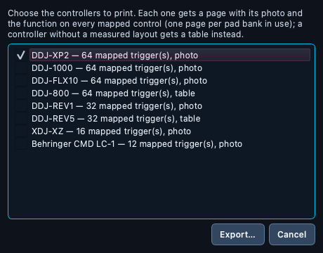
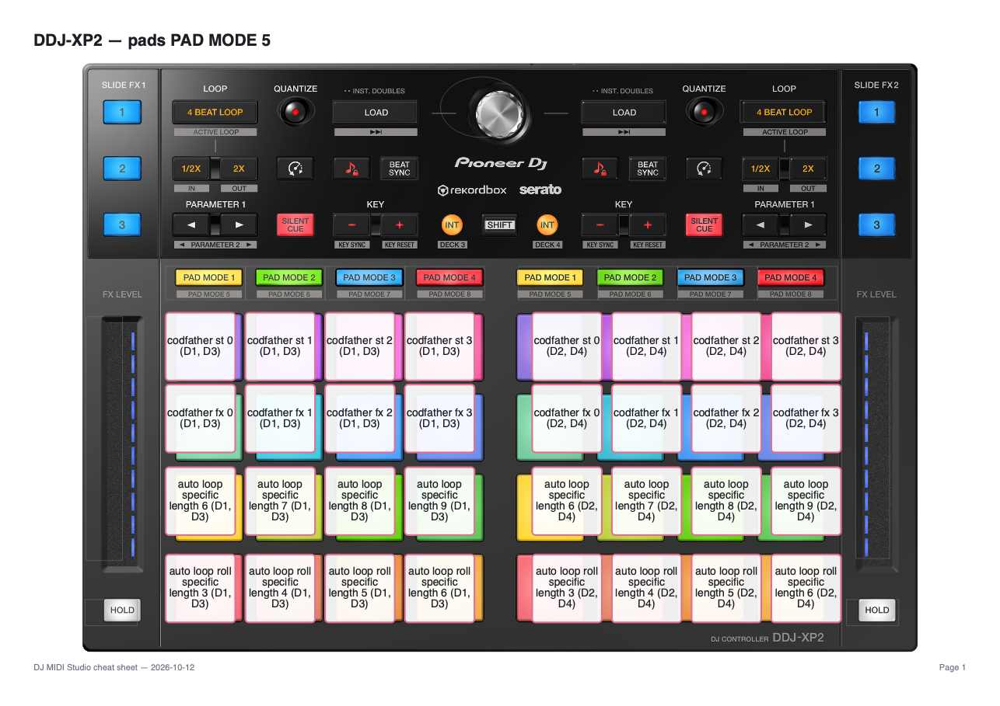

# 🖨️ Cheat Sheet (PDF)

> A printable page per controller: its photo with, on every pad and
> button, the function your loaded mapping gives it. Print it or keep it on
> a tablet at the gig.

📍 [Docs](../../README.md) › [End user](../README.md) › [Features](README.md) › Cheat Sheet (PDF)

## Table of Contents

- [Export a cheat sheet](#export-a-cheat-sheet)
- [Choose the controllers](#choose-the-controllers)
- [What each page shows](#what-each-page-shows)
- [Pad banks and SHIFT](#pad-banks-and-shift)
- [Controllers without a photo layout](#controllers-without-a-photo-layout)
- [Related](#related)

## Export a cheat sheet

1. Open a mapping (`File → Open Mapping...`).
2. Choose `File → Export → Cheat Sheet (PDF)...`.
3. Tick the controllers to print, click `Export…`, and pick where to save.
   The dialog starts in the `Exports` folder of your
   [workspace](workspace.md).

The PDF is A4 landscape. Nothing in your mapping is changed.

## Choose the controllers

A mapping file does not say which controller it was made for: the same
MIDI notes often mean a pad on several Pioneer models. The dialog lists
every controller that recognizes at least one trigger of the mapping, with
how many it recognizes, and ticks the likely ones for you: the controllers
connected right now and the one shown in
[Controller Images](controller-images.md). Untick or tick as you like.

## What each page shows

- The clean controller photo, with each mapped control labelled in place:
  the function's [readable name](function-names.md) and slot
  (`Codfather ST · slot 0`, `Auto loop · slot 8`) — or the tag as Serato or
  Traktor calls it when it has no short name — and the decks it applies to
  (`D1, D3`).
- A control too small to hold its label gets a red number instead, and
  the number is explained in a legend under the photo.
- Unmapped controls keep a faint outline, so the page still reads as the
  device.
- The footer names the mapping file and the export date.
- A last **Function names** page lists every short name used with the
  Serato tag it stands for.

Functions come from the mapping's input (press) bindings, resolved the
same way as the [Controller Emulator](controller-emulator.md)'s dry run;
LED feedback bindings are not listed.

## Pad banks and SHIFT

Pads send a different MIDI note in each pad mode, so each pad mode your
mapping uses gets its own page (`DDJ-XP2 — pads PAD MODE 5`). The first
page also shows the other buttons; the following ones show the pads only.

A control whose SHIFT layer is mapped too shows both, the SHIFT function on
a `SHIFT:` line. Both decks that share a physical control (decks 1 and 3 on
the left pads, 2 and 4 on the right) appear on the same label.

## Controllers without a photo layout

A controller whose control positions haven't been measured yet, and any
mapped control that has no marker on the photo, is listed in a table:
section, control, function. A controller with nothing mapped still gets a
page saying so.

## Related

- [Controller Emulator](controller-emulator.md)
- [Readable function names](function-names.md)
- [Controller Images](controller-images.md)
- [Mapping editor](mapping-editor.md)
- [Workspace and preferences](workspace.md)
