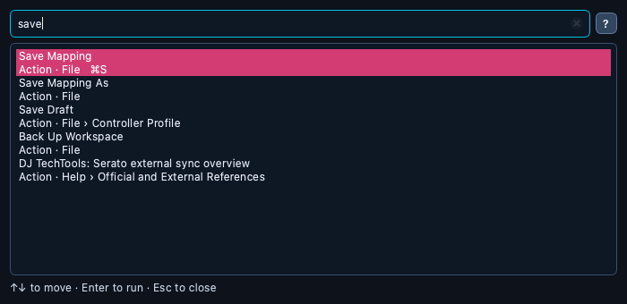

# ⌨️ Command palette

> Press **Cmd+K** (Ctrl+K on Windows and Linux), type a few letters, press
> **Enter**: one search reaches every menu action, every tab, the loaded
> mapping's functions and your Music Library's tracks — without the mouse.

📍 [Docs](../../README.md) › [End user](../README.md) › [Features](README.md) › Command palette

## Table of Contents

- [Opening it](#opening-it)
- [What it finds](#what-it-finds)
- [How results are ordered](#how-results-are-ordered)
- [Keys](#keys)
- [Related](#related)

## Opening it

**Cmd+K** from anywhere in the app — including a floating tool window — or
**View → Command Palette**. With nothing typed yet it lists every menu
action and tab, in menu order, so you can also browse it.

## What it finds

| Kind | Examples | Enter does |
| --- | --- | --- |
| **Action** — every enabled menu entry, with its menu path and shortcut | `save`, `cheat` (Cheat Sheet), `opmap` (Open Mapping), `performance` | runs it, as if picked from the menu |
| **Tab** | `by deck`, `library` | switches to that tab |
| **Function** — of the open mapping, through [Find function](mapping-editor.md) | `loop roll deck 2`, `codfather output` | selects its controls, outlined on the layouts |
| **Track** — in the [Music Library](music-library.md) | an artist, a title, an album, a file name | opens the Music Library on that track |

- A menu entry that is greyed out (Save with no mapping open) is left out
  rather than listed and ignored. A toggle shows its state:
  `Performance Mode (off)`.
- Functions understand everything Find function does: `deck 2`, `slot 3`,
  `output` for LED feedback (or their French equivalents `platine 2`,
  `emplacement 3`, `sortie`), the short name or the original Serato tag.
- Tracks appear from two typed letters on, and only once the Music Library
  tab has been opened in this session (the palette never opens your library
  index by itself). If a library filter hides the track, the filters are
  cleared so it can be shown.

## How results are ordered

Every word you type must match. A whole word beats the start of a word,
which beats a piece of a word, which beats letters in order (`cs` finds
**C**heat **S**heet). Typing several words in the order of the name ranks
it higher. On a tie, actions come first, then tabs, functions and tracks —
a track called *Save* never pushes **Save Mapping** down.

## Keys

| Key | Does |
| --- | --- |
| **↑ / ↓**, **Page Up / Page Down** | move the highlighted result |
| **Enter** | run or open it |
| **Esc** | close the palette |

The mouse works too: click a result to run it.

## Related

- [Mapping editor](mapping-editor.md): Find function and the three trees.
- [Music Library](music-library.md): the track table the palette opens.
- [Workspace and preferences](workspace.md): menus, tool windows and Performance Mode.
