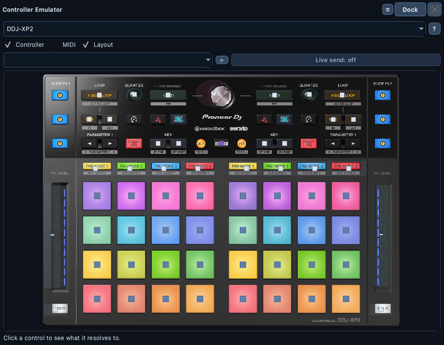

# 🕹️ Controller Emulator

> A clickable, on-screen twin of your controller: press pads, switch modes,
> hold SHIFT, turn knobs, and see exactly what the loaded mapping does — or
> send the real MIDI to your software.

📍 [Docs](../../README.md) › [End user](../README.md) › [Features](README.md) › Controller Emulator

## Table of Contents

- [What it does](#what-it-does)
- [Open an emulator](#open-an-emulator)
- [Click to resolve a control](#click-to-resolve-a-control)
- [Modes, SHIFT and selections](#modes-shift-and-selections)
- [Knobs, faders and jog wheels](#knobs-faders-and-jog-wheels)
- [Send real MIDI (Live send)](#send-real-midi-live-send)
- [Live feedback from the hardware](#live-feedback-from-the-hardware)
- [Pad colours](#pad-colours)
- [Every controller](#every-controller)
- [Related](#related)

## What it does

The emulator draws one controller's surface — on its real photo, at each
control's true position, for the controllers with measured geometry — and
lets you play it with the mouse. Use it to understand a mapping without the
hardware on your desk, to test a mapping change, or to drive your DJ
software from the screen.

## Open an emulator

`View → New Controller Emulator…`, then pick a controller. Open as many as
you like, each on its own controller (for example a DDJ-XP2 next to an
XDJ-XZ). Each one is a window you can dock, float, maximize or snap to a
side. The set of open emulators is restored at the next launch.

The [display layers](controller-images.md#display-layers) choose what's
drawn: the `Controller` photo (on by default), the `MIDI` picture alone, and
the `Layout`, which holds the clickable controls.

## Click to resolve a control

Click a pad or button: it flashes, and the status line shows what the
loaded mapping binds that trigger to (deck, function, toggle/explicit
behaviour). Nothing is sent unless [Live send](#send-real-midi-live-send) is
on.

A control mapped as an on/off toggle keeps an amber highlight while "on",
just like the hardware LED.

## Modes, SHIFT and selections

The emulator remembers state the way the hardware does:

- **Pad modes**: click a mode button (DDJ-XP2 `PAD MODE 1–4`, XDJ-XZ
  `HOT CUE` / `BEAT LOOP` / `SLIP LOOP` / `BEAT JUMP`) and the next pad
  clicks use that mode's bank.
- **SHIFT**: click SHIFT to latch it (it stays lit); pads and buttons then
  resolve to their shifted function. Click again to release.
- **One-of-many selections** (for example the auto-loop length slots on a
  deck): selecting one lights it and turns the previous one off.

## Knobs, faders and jog wheels

Drag a knob, fader or jog wheel vertically to move it. This is visual only:
continuous controls aren't part of the controller profiles, so dragging
never resolves or sends anything.

## Send real MIDI (Live send)

Switch `Live send: off` to `LIVE SEND: ON` and pick an output port (`⟳`
refreshes the list). Every pad or button click then also sends the real MIDI
message to that port, so the emulator can play your DJ software. Live send
is off by default.

## Live feedback from the hardware

Each emulator also follows the real controller, for the controller it shows:
a hardware hit flashes the matching control, a held button stays amber until
released, and LED messages sent by Serato latch the amber highlight (see
[Live Monitor](live-monitor.md#see-what-serato-sends-back-led-feedback)).

## Pad colours

Some controllers light each pad in a colour chosen by the MIDI velocity sent
to it. When the controller's official MIDI documentation lists which velocity
gives which colour, the emulator shows a **Pad colours** row. Today that is
only the **Hercules DJControl Inpulse 500**: the Pioneer / AlphaTheta MIDI
message lists only say "colour number 1-127" without the table, and the app
never guesses colour values.

1. Pick the **deck**, the **pad mode** and whether the colour is for the
   **SHIFT** layer. The documentation gives each pad mode and SHIFT layer its
   own LED, so each one keeps its own colours.
2. Pick a colour (the 19 documented ones, from `No light` to `White`) and
   switch **Paint** on.
3. Click pads. Each one takes the colour in the emulator. With
   [Live send](#send-real-midi-live-send) on, the controller lights up too.
   While Paint is on, a pad click doesn't resolve the pad.
4. Click **Save to sync set**. The colours are stored in the controller's
   [sync set](controller-sync.md) for the active scene, so every Sync
   lights the pads again. A pad that already had a colour in the set gets
   the new one, and the set's other messages are kept.

The row reads saved colours back from the sync set when the emulator shows
the controller or when you switch scene. Switching scene drops colours you
haven't saved.

## Every controller

Every registered controller has an emulator, including ones you build with
[Controller Setup](controller-setup.md). The
[Controller Layout Gallery](../../images/controllers/README.md) shows each
built-in one.

## Related

- [Live Monitor](live-monitor.md)
- [Controller Images](controller-images.md)
- [Mapping editor](mapping-editor.md)
