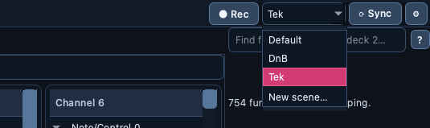

# ⟳ Controller Sync

> One button brings every connected controller into a known state: pad
> modes, LEDs, banks — whatever you recorded for it, sent to all of them at
> once.

📍 [Docs](../../README.md) › [End user](../README.md) › [Features](README.md) › Controller Sync

## Table of Contents

- [Why Sync](#why-sync)
- [Record a sync set](#record-a-sync-set)
- [Sync your controllers](#sync-your-controllers)
- [Sync at launch](#sync-at-launch)
- [Sync when a controller is plugged in](#sync-when-a-controller-is-plugged-in)
- [Scenes: several sets per controller](#scenes-several-sets-per-controller)
- [How Sync finds each controller](#how-sync-finds-each-controller)
- [Manage sync sets](#manage-sync-sets)
- [Related](#related)

## Why Sync

After plugging controllers in, or after DJ software has reset them, you
usually press the same buttons every time: pick a pad mode, light a bank,
select a deck. Sync records those presses once per controller and replays
them all with a single click, on every connected controller at the same
time.

## Record a sync set

The quickest way is the **`● Rec`** button at the top right of the menu bar:

1. Click **`● Rec`**: the app listens to every connected MIDI controller.
2. Press the controls you want sent at initialization, in order, on any
   number of controllers.
3. Click **`■ Stop`**. One set is saved per recognized controller that sent
   something, named after that controller. A port the app doesn't recognize
   — an unknown device, a loopback bus such as "IAC Driver Bus 1", another
   program's virtual port, or a port that only carries a maker's name such as
   "Pioneer DJ …" — is ignored and listed in the status bar, so it is never
   replayed at launch. A second identical unit gets its own set, named after
   its port. Inputs that couldn't be opened (in use by another program) are
   listed in the status bar too. Controllers the Live Monitor is already
   listening to are recorded through it, without opening them a second time
   (Windows lets only one program at a time open a MIDI input).

While `● Rec` records, controller-bound [macros](midi-macros.md) don't play
and a pending MIDI Learn doesn't take the press: every press goes to the
recording only. Both work again after `■ Stop`.

A fader, knob or jog moved while recording sends hundreds of messages; only
its final position is kept, at the point where you last moved it, so the
order of buttons and final positions is preserved. The status bar says how
many such messages were collapsed. Controller Setup keeps every recorded
row, since you review them there before saving.

Quitting the app while `● Rec` is on asks whether to save the recording,
discard it, or keep the app open.

To record an unknown controller, or a single controller under a name you
choose:

1. Open [Controller Setup](controller-setup.md) and type the controller's
   name.
2. Tick its input port and click `Start learning`.
3. Press the controls you want sent at initialization, in order.
4. Click `Stop learning`, then `Save as controller sync set`
   (`MIDI Output` → `Playback`).

Both save into the active [scene](#scenes-several-sets-per-controller)
(`Default` unless you picked another). There is one set per controller and
scene; saving again for the same controller in the same scene asks before
replacing the existing set. `● Rec` asks once for every set it would
replace: **No** keeps them, and still saves the controllers that had none.

Pad colours chosen in the [Controller Emulator](controller-emulator.md#pad-colours)
are added to the same set instead of replacing it (only for controllers whose
documentation lists the pad colours).

## Sync your controllers

Click **`⟳ Sync`** at the top right of the menu bar (beside the ⚙
Preferences button), or **`Sync controllers`** in the
[Live Monitor](live-monitor.md).

Each set is sent in recorded order, immediately (the pauses from the
recording are dropped), through one connection to its output port that
stays open for the whole set. The status bar shows how many controllers were
synced and which ones were not connected.

## Sync at launch

With ⚙ **Preferences** → **Sync controllers at launch** ticked (the
default), every stored set is sent once when the app starts, as if you had
clicked `⟳ Sync`. Nothing happens when no set is recorded. Untick it to
sync only on demand.

## Sync when a controller is plugged in

With ⚙ **Preferences** → **Sync a controller when it is plugged in** ticked
(the default), the app checks for newly connected controllers every two
seconds. As soon as a controller with a stored set appears, its set is sent
once and the status bar says so (`Plugged in -- Synced …`).

- A controller that stays connected is never sent its set again.
- Unplug it and plug it back in: its set is sent again.
- Controllers already connected when the app starts are handled by
  [Sync at launch](#sync-at-launch), never twice.

Untick it if you prefer to click `⟳ Sync` yourself after plugging in.

## Scenes: several sets per controller

A scene is a named group of sync sets — say `Tek`, `DnB` and `Warm-up` —
so each controller can have a different initialization per kind of set you
play. The scene combo between **`● Rec`** and **`⟳ Sync`** picks the
active one:

- **`⟳ Sync`**, [Sync at launch](#sync-at-launch) and
  [Sync when plugged in](#sync-when-a-controller-is-plugged-in) send each
  controller **its set for the active scene**.
- A controller with no set for that scene gets **its `Default` set**
  instead, so you only record the controllers that differ. A controller
  with neither is left alone.
- **`● Rec`** and Controller Setup's `Save as controller sync set` record
  into the active scene.
- Choose **`New scene…`** in the combo to name a new scene; it becomes
  active and stays in the list once a set is recorded for it.

Switching scenes sends nothing by itself — click `⟳ Sync` when you want the
controllers to follow — unless ⚙ **Preferences** → **Sync when switching
scene** is ticked (off by default): then picking another scene sends each
connected controller its set for the new scene straight away, and the status
bar reports it (`Sync scene: Tek -- Synced …`). Re-picking the scene that is
already active sends nothing, and a scene with nothing to send stays silent. The active scene is remembered across restarts. Sets
recorded before scenes existed are your `Default` scene.

## How Sync finds each controller

1. The output port the set was recorded on, if it is connected.
2. Otherwise, an output port whose name contains the recorded port name or
   the controller name, ignoring case and punctuation (`DDJ-XP2` matches
   `PIONEER DDJ-XP2`).
3. Otherwise, for a controller the app knows, the one connected output port
   recognized as that controller — Windows renumbers ports as devices come
   and go (`CMD Micro 0` recorded, `CMD Micro 2` now).
4. Otherwise the controller is skipped and reported. The other controllers
   are still synced.

## Manage sync sets

Open ⚙ **Preferences** → **Controller sync**. Each set shows its scene and
message count; choose which output port it goes to (`Auto` follows the rules above)
or remove it.

To fix a set without recording it again, select it and click
**`Edit messages…`** (or double-click it). The editor lists its messages in
the order they are sent:

- Change a message's type (`Note On`, `Note Off`, `Control Change`) or
  double-click its channel (1–16) or data values (0–127) to edit them.
- `Delete` removes the selected message; `Move up` / `Move down` reorder it.
- `Send selected` sends the selected message to the controller right away,
  to check what it does (greyed out when the controller is not connected).

An invalid value is pointed out and `OK` is refused until it is fixed.
`OK` keeps the changes in the Preferences dialog; they are written when you
click `Save` there (`Cancel` drops them).

Each set is a file in `Documents/DJ MIDI Studio/Sync`, one per controller
and scene (`ddj-xp2.json` for the `Default` scene, `ddj-xp2.tek.json` for
`Tek`), so you can back it up or copy it to another computer. Sets recorded with an
older version are moved there automatically the first time you start this
one.

## Related

- [Controller Setup](controller-setup.md): where sync sets are recorded.
- [Live Monitor](live-monitor.md): check what each controller sends.
- [Workspace and preferences](workspace.md): the ⚙ Preferences dialog.
