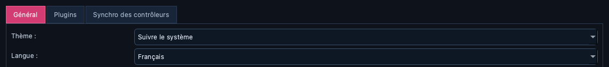
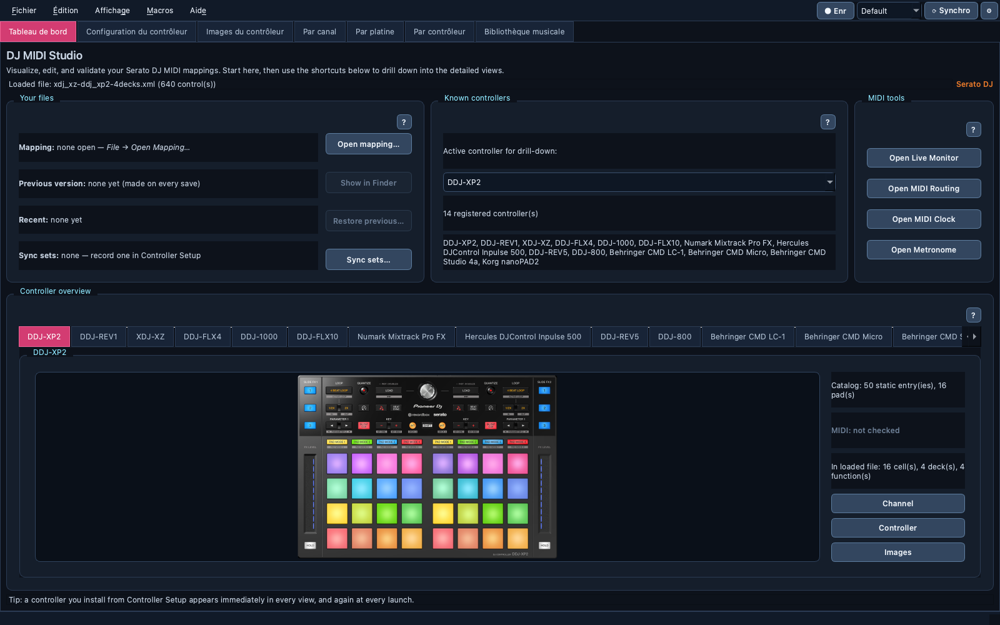

# 🌐 Interface language

> Show DJ MIDI Studio in French (or follow your computer's language)
> instead of English. Chosen in Preferences, applied at the next launch.

📍 [Docs](../../README.md) › [End user](../README.md) › [Features](README.md) › Interface language

## Table of Contents

- [Choose a language](#choose-a-language)
- [What is translated](#what-is-translated)
- [What stays in English](#what-stays-in-english)
- [Related](#related)

## Choose a language

Open Preferences with the **⚙** button at the top right, then pick a
`Language` on the `General` tab:

| Choice | Shows |
| --- | --- |
| `English` | English — the default |
| `Français` | French |
| `System` | French when your computer's language is French, English otherwise |

Click `Save`, then quit and restart DJ MIDI Studio: the language is applied
when the app starts. Language names are always written in their own
language, so you can find yours even when you can't read the current one.

## What is translated

This first version translates what you use most:

- the menu bar: `Fichier`, `Édition`, `Affichage`, `Macros`, `Aide` and
  every fixed entry in them;
- the main tabs: `Tableau de bord`, `Config. contrôleur`,
  `Images contrôleur`, `Par canal`, `Par platine`, `Par contrôleur`,
  `Bibliothèque` (kept short so they fit a small window; when they still
  don't, the tab bar shows scroll arrows instead of cutting the names);
- the content of the `Tableau de bord` cards, `Config. contrôleur` (with
  its submission window), `Images contrôleur` and the three mapping tabs
  `Par canal`, `Par platine`, `Par contrôleur`: column headers, filters,
  the display layers (`Contrôleur`, `MIDI`, `Disposition`), **Envoi live**,
  and the editing column beside them (the edit panel and MIDI Learn, the
  function search, `Valider` and `Prêt pour le live…`);
- the **● Rec** / **⟳ Sync** buttons and the sync-scene list beside the
  menu bar, with their tooltips, the messages they show in the status bar
  and their questions (replacing a stored sync set, quitting while
  recording);
- the whole Preferences window;
- the first-run setup wizard (`Aide → Configuration initiale…`), the
  `Prêt pour le live` report, the `Test de latence MIDI` and the
  `Carte des couches` windows;
- the whole Music Library tab: the music folders, the table and its
  filters, the `Morceau`, `Catégories`, `Playlists`, `Historique` and `Set`
  panels (with the Set panel's summary and transition notes), the preview
  bar, the status line and every window its buttons open, including
  `Trouver les doublons…` and `Bilan de santé…`, and the smart-playlist
  rule summaries and sort orders;
- the Sync result summary shown in the status bar, and the Live Monitor's
  lock tooltip while **● Enr** records;
- every `?` help popup, on every tab and tool window, Controller Setup's
  included (its `Ouvrir le guide complet` button still opens the English
  guide); a button that is still in English is named in English there, so
  you find it on screen;
- Qt's own standard buttons and dialogs (`OK`, `Annuler`, `Enregistrer`,
  file pickers).

## What stays in English

Most other messages are still in English, as is this documentation
(including the guides the `?` help popups open). In the mapping tabs,
the names Serato gives its own fields stay as written (`Deck set`,
`Slot id`, `action_on`, `behaviour`, `Control`, `User I/O`), the function
search understands English words (`deck 2`, `slot 3`, `click`, `output`),
and Controller Setup's port and number errors (`Channel must be an
integer`) and its row sources (`learned`, `xml-import`) stay in English.
Text computed from your data follows the interface language — the
`Prêt pour le live` findings, the latency statistics line, the
change-history entries — but CSV exports stay in English (a health-report
CSV keeps its issue names in English, and a saved Live Monitor log keeps
English column names), and a validation message or a detection reason
still shows in English. They will be
translated over the next releases. Controller and function names that
come from your DJ software or your controller's MIDI documentation are
never translated.

## Related

- [Workspace and preferences](workspace.md#preferences)
- [User guide](../user-guide.md)
