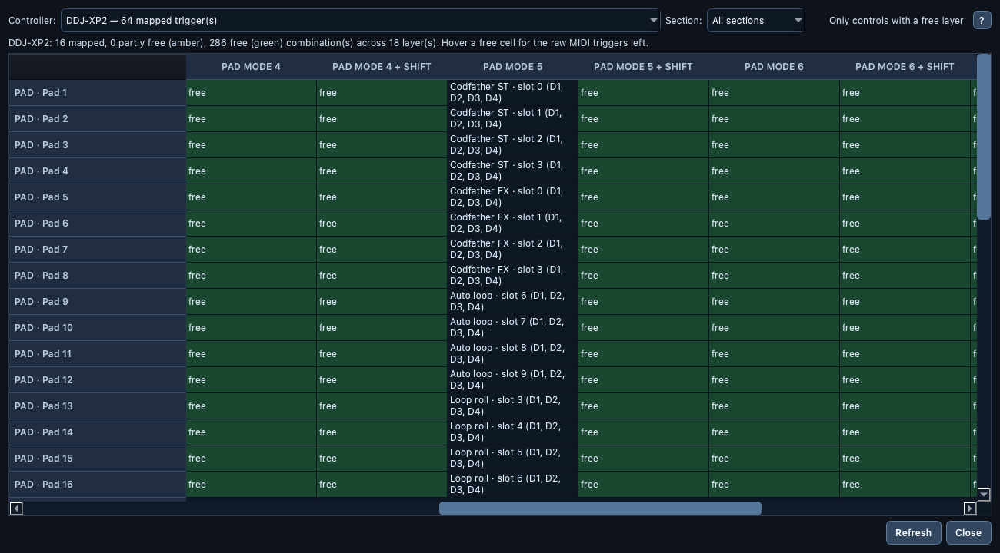

# 🧩 Layer Map

> One table per controller: every physical control down the side, every
> layer across the top — normal, SHIFT, each pad mode — and what your
> mapping does in each combination. The free ones are highlighted, so you
> see at a glance where a new function fits.

📍 [Docs](../../README.md) › [End user](../README.md) › [Features](README.md) › Layer Map

## Table of Contents

- [Open the Layer Map](#open-the-layer-map)
- [Reading the table](#reading-the-table)
- [Where the layers come from](#where-the-layers-come-from)
- [Filters and refresh](#filters-and-refresh)
- [Related](#related)

## Open the Layer Map

1. Open a mapping (`File → Open Mapping...`).
2. Choose `View → Layer Map…`.
3. Pick the controller at the top. The controllers that recognize your
   mapping come first, with how many of its triggers they recognize; every
   other known controller follows, so you can also look for room on one
   you haven't mapped yet.

The window stays open beside the editor. It only reads: nothing in your
mapping or on your controller changes.

## Reading the table

- **One row per physical control.** Every deck's copy of a pad shares one
  row (`PAD · Pad 3`), and a button shares one row with its SHIFT and
  long-press variants.
- **One column per layer**: `Normal`, `SHIFT`, then each pad mode with and
  without SHIFT (`PAD MODE 2`, `PAD MODE 2 + SHIFT`, `HOT CUE mode`, …).
- **A mapped cell** shows the function's [readable name](function-names.md)
  and the decks it applies to: `Codfather ST · slot 0 (D1, D2, D3, D4)`.
- **`free` (green)**: no deck uses this combination — a new function fits
  here. Hover it to see its raw MIDI triggers (`ch 9 · Note 18`).
- **Amber**: mapped on some decks only. Hover it to see the MIDI channels
  still free.
- **`—`**: this control has no such layer (a button has no pad mode).

The line above the table counts the mapped, partly free and free
combinations.

## Where the layers come from

Only from the controller's profile: a layer exists because the profile
names a MIDI trigger for it. A controller whose profile has no SHIFT
variants shows no SHIFT column, and pads without pad modes show a single
`Normal` column. Output-only entries (LED feedback) are left out — they
are no place for a function. Like the [Cheat Sheet](cheat-sheet.md), only
what a control *does* (its input mapping) counts; LED feedback doesn't
make a combination busy.

## Filters and refresh

- **Section** shows one part of the controller (`PAD`, `DECK`, …); the
  columns shrink to the layers that part has.
- **Only controls with a free layer** hides the controls that are fully
  mapped.
- **Refresh** re-reads the mapping after you edit it in the editor.

## Related

- [Cheat Sheet (PDF)](cheat-sheet.md)
- [Controller Emulator](controller-emulator.md)
- [Mapping editor](mapping-editor.md)
- [Readable function names](function-names.md)
- [Supported controllers](../controller-profiles.md)
