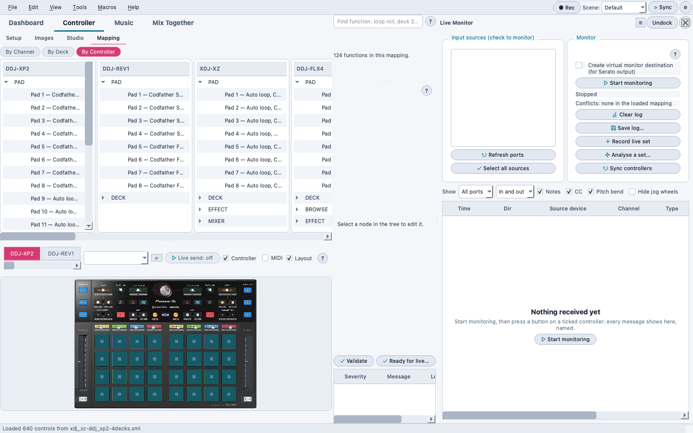

# 📡 Live Monitor

> See every MIDI message your controllers send, in real time, already
> translated into the physical control and the DJ-software function it
> triggers. The whole app reacts as you play.

📍 [Docs](../../README.md) › [End user](../README.md) › [Features](README.md) › Live Monitor

## Table of Contents

- [What it does](#what-it-does)
- [Start monitoring](#start-monitoring)
- [Read the event log](#read-the-event-log)
- [Spot conflicts live](#spot-conflicts-live)
- [The whole app lights up](#the-whole-app-lights-up)
- [See what Serato sends back (LED feedback)](#see-what-serato-sends-back-led-feedback)
- [Record a whole live set](#record-a-whole-live-set)
- [Analyse a recorded set](#analyse-a-recorded-set)
- [Limits](#limits)
- [Related](#related)

## What it does

Live Monitor listens to your MIDI inputs and logs each event with its
source device, channel and value, plus the **physical control** (`PAD ·
Pad 3`) and the **mapped function** from the loaded mapping. Every live
event also drives the controller layouts, the [Controller
Images](controller-images.md) overlay and every open [Controller
Emulator](controller-emulator.md), so the screen mirrors what your hands do
on the hardware.

## Start monitoring

By default there is nothing to start: as soon as a mapping is loaded, the
app listens on every available MIDI input (⚙ Preferences → `Auto-start Live
Monitor when a mapping is loaded`, on by default). A port that is busy is
skipped quietly.

To choose ports yourself, open `Tools → Live Monitor`, then:

1. `Refresh ports`, then tick the inputs to watch (or `Select all sources`).
2. Click `Start monitoring`.
3. Press a button or pad on the controller.

Your manual port choice is never overridden by the auto-start.

While [`● Rec`](controller-sync.md) records, `Start monitoring`/`Stop monitoring`
and the input list are greyed out until `■ Stop`: the recording reads the inputs
the monitor already holds, so they must not change underneath it. A mapping
loaded meanwhile starts the monitor right after `■ Stop`.

## Read the event log

| Column | Meaning |
| --- | --- |
| Time | When the message arrived |
| Dir | `in` (controller → computer) or `out` (software → controller) |
| Source device | The MIDI port it came from |
| Channel, Type, Data1, Data2 | The raw MIDI message (Note On/Off, Control Change or Pitch Bend, number, value) |
| Physical / Serato | The physical control, then the mapped function |

A **Pitch Bend** message has no number (Data1 is 0) and a value from 0 to
16383, 8192 being the centre. It is logged and saved with the log, but it
never selects or lights a control.

### Filter the log

The **Show** row under the controls narrows what the log shows: one port
(**All ports** lists every port seen so far), **In only** or **Out only**,
**Notes**, **CC** and **Pitch bend**, and **Hide jog wheels** (a jog sends
dozens of messages per turn). It only hides rows: everything else —
the drawings, captures, macros, and **Save log…** — still gets every
message, and changing a filter shows the hidden rows again at once. The
count on the right says how many rows are hidden.

Physical names are matched against the source device, so a pad on one
controller is never mistaken for the same note on another one.
`Clear log` empties the table; `Save log…` exports it, either as a CSV
table or as a **MIDI file** (`.mid`, pick it in the file type list). The
MIDI file keeps the real timing — one track per port, plus a `(out)` track
for what the DJ software sent back — so a session can be opened in a DAW
or any MIDI tool, replayed, or attached to a bug report. `Sync controllers`
runs [Controller Sync](controller-sync.md).

A controller can send hundreds of messages in a fraction of a second (a
jog wheel spun fast, a fader swept, LED feedback): the drawings redraw once
per batch of messages, so the window keeps up. Such a burst is noted in the
log file with what sent it, and if the window ever stops responding for
5 seconds, the log records where — attach the log to a problem report
(`Help → Report a Problem…`).

## Spot conflicts live

When a button or pad you press triggers **two or more different functions
on the same deck** of the loaded mapping, its log row turns amber and the
`Physical / Serato` column starts with `CONFLICT`, followed by the deck and
the clashing functions (for example `CONFLICT deck 1: cue (slot 0), play
(slot 0)`). The `Conflicts:` counter under the status counts those hits and
how many different triggers they came from; `Clear log` and loading another
mapping reset it.

Serato writes every trigger several times over with identical content; that
repetition is normal and is **never** reported as a conflict. The same
function on two different decks isn't a conflict either, and LED messages
(`out`) are not checked. A release (`Note On` at velocity 0) is still
flagged in its row but not counted again.

## The whole app lights up

For the controller each view is showing:

| You do | The screen shows |
| --- | --- |
| Hit a pad or button | The red selection border jumps to it and the glyph flashes white |
| Hold a button down | A steady amber "held" highlight until you release it |
| Turn a knob, move a fader | The knob rotates / the fader thumb moves, and stays where you left it |
| Spin a jog wheel | The jog glyph turns (XDJ-XZ, DDJ-1000, DDJ-FLX10, DDJ-FLX4, DDJ-REV1, DDJ-REV5, DDJ-800, Hercules DJControl Inpulse 500) |

## See what Serato sends back (LED feedback)

DJ software lights the controller's LEDs by sending MIDI *out* to it. macOS
doesn't let a third app see that traffic directly, so add the app's virtual
port **`DJMidiStudio Monitor`** as an *extra* MIDI output in Serato's MIDI
settings. LED messages then appear as `out` events and latch the same amber
highlight on screen until Serato switches the LED off.

## Record a whole live set

The event log keeps the last 500 events, and **Save log…** saves those. A
live set produces far more: a 2.5-hour set sent over 200,000 events, most of
them jog wheel ticks. To keep all of it, click **Record live set** before
you play. Monitoring starts on every MIDI input if it isn't running yet
(plug every controller in first), and every event from then on is written
straight to a file, with no limit: the count shows under the button. Click
**Stop recording** at the end; stopping monitoring or quitting the app
stops it too.

The file lands in `Documents/DJ MIDI Studio/Logs`, named after the start
time (`live-20261116-183915.jsonl`), one event per line: its time, port,
direction, channel, type and values. It's written as you play, so a crash
loses about a second at most. Keep it to look back at what you actually
used during a set: which buttons, how often, which ones follow each other.

## Analyse a recorded set

**Analyse a set…** opens a recording from the `Logs` folder and shows what
it says about how you play. Nothing is changed.

| Tab | What it shows |
|---|---|
| **Buttons** | Every press per physical control (deck told apart by its channel), most used first |
| **Jogs, knobs and faders** | The continuous controls that moved, by number of messages; named from the maker's MIDI list where we have it (XDJ-XZ mixer, EQ, COLOR, tempo; DDJ-XP2 touch strip and browse), else shown as `CC n · ch c` |
| **Sequences** | Two different buttons pressed within 1.5 s of each other, and how often: a CUE then PLAY you repeat is a macro waiting to be made |
| **Activity** | Presses per 10 minutes: where the set was busy, where you paused |

Controls are named by your controllers' profiles; one no profile knows
keeps its note or CC number and channel. Recordings made by the earlier
standalone recorder script open too.

## Limits

- VU meters don't react: no level data is available to drive them.
- An LED is matched on the same note number as the button that triggers it,
  which is Serato's usual convention.

## Related

- [Controller Emulator](controller-emulator.md): the same live feedback on
  an interactive schematic.
- [Controller Sync](controller-sync.md): the `Sync controllers` button.
- [MIDI Routing and Clock](midi-routing-and-clock.md): forward MIDI between
  devices.
