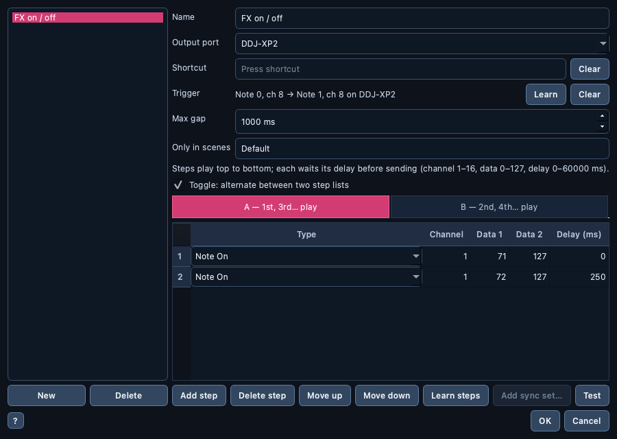

# ⏯️ MIDI Macros

> Name a list of MIDI messages once, then send it in one go from the
> `Macros` menu, a keyboard shortcut or a button on your controller — with
> an optional pause before each message.

📍 [Docs](../../README.md) › [End user](../README.md) › [Features](README.md) › MIDI Macros

## Table of Contents

- [Why macros](#why-macros)
- [Create a macro](#create-a-macro)
- [Play a macro](#play-a-macro)
- [Play a macro from a controller button](#play-a-macro-from-a-controller-button)
- [Toggles, scenes and waits](#toggles-scenes-and-waits)
- [Where the messages go](#where-the-messages-go)
- [Macro files](#macro-files)
- [Related](#related)

## Why macros

[Controller Sync](controller-sync.md) puts every controller in its starting
state with one click. Macros are for everything else you send by hand
more than once: switching a bank of LEDs, firing a short press-and-release,
changing an effect on an external unit, a test message while building a
mapping. Each macro has a name, an output port, its messages in order and,
if you want, a keyboard shortcut.

## Create a macro

Open **`Macros` → `Manage Macros…`**:

1. Click **`New`** and type the macro's name.
2. Pick its **output port** (or type a controller name, see
   [below](#where-the-messages-go)).
3. Add its steps with **`Add step`** (a new step copies the selected one),
   then change each step's type (`Note On`, `Note Off`, `Control Change`),
   channel (1–16), data 1 and data 2 (0–127). **`Add sync set…`** appends
   the messages of a recorded [sync set](controller-sync.md) instead of
   typing them.
4. Optionally give a step a **delay** (0–60000 ms): the macro waits that
   long before sending it — for example a `Note On`, then the matching
   `Note Off` 200 ms later.
5. Optionally click the **Shortcut** field and press a key combination.
   `Clear` removes it.

Instead of typing the steps, you can **play them**: click **`Learn steps`**,
then play the notes on your controller. Each message it sends (press,
release, knob move) is added as a step, with the delay you actually waited
since the previous one — the first one starts at 0 ms. Click `Learn steps`
again (it reads `Stop`) when you are done; it also stops after 10 seconds
without a message. The steps are added after the existing ones, so you can
record in several goes, and you can edit or delete them like any other.

`Move up` / `Move down` reorder the selected step, `Delete step` removes it,
and **`Test`** plays the macro exactly as edited. `OK` saves every macro;
an invalid value, a shortcut already used by the app's menus (`Ctrl+O`,
`Ctrl+S`…) or by another macro, or two macros with the same name is pointed
out and `OK` is refused until it is fixed.

## Play a macro

Pick it in the **`Macros`** menu, or press its shortcut — from any tab, and
also while a floating tool window (Live Monitor, an emulator…) has the
focus. The status bar says how many messages were sent and where, or why
nothing was sent (no port chosen, port not connected).

Delays never freeze the app: the screen keeps reacting while a macro waits,
and you can start another macro meanwhile. A send that fails stops that
macro, since the next steps may depend on it.

## Play a macro from a controller button

A macro can also be fired by a button (or knob, fader…) on your
controller — or by a **series of buttons** pressed in order — with
**MIDI Learn**:

1. In **`Macros` → `Manage Macros…`**, select the macro.
2. Next to **Trigger**, click **`Learn`**, then press the button on your
   controller within 10 seconds — or several buttons, one after the other.
   Every press is added to the trigger, which shows what was learned, for
   example `Note 40, ch 1 → Note 41, ch 1 on PIONEER DDJ-XP2`.
3. Learning stops by itself once you stop pressing for the **Max gap**
   (1000 ms by default), or when you click `Learn` again (it reads `Stop`).
4. Click `OK`. The trigger is saved in the macro's file.

From then on, pressing that button — or those buttons in that order, each
within the **Max gap** of the previous one — plays the macro, whichever tab
is open. Pressing another button in between, or waiting too long, starts
the series over; knob, fader and jog moves in between don't. Only presses
count — releasing a button doesn't play it a second time — and a knob or
fader (a Control Change) used as a trigger fires on every move, so buttons
are usually the better choice. `Clear` removes the trigger; a new `Learn`
replaces it.

- The app listens through the [Live Monitor](live-monitor.md): `Learn`
  starts it on every MIDI input if it isn't running yet, and at launch it
  starts on its own when a macro has a trigger (unless *Auto-start Live Monitor when a
  mapping is loaded* is off in Preferences; then start it yourself).
- A trigger remembers the input it was learned on, so the same note on
  two controllers stays two different triggers.
- Macros don't play from the controller while `Manage Macros…` is open,
  so learning a button never fires its old macro.
- Macros don't play from the controller while **`● Rec`** records a
  [sync set](controller-sync.md) either: those presses belong to the recording.
- `OK` is refused when two macros use the same trigger, when one macro's
  series of presses is part of another's (it would fire in the middle of
  it — for example `A` then `B` next to a macro triggered by `B` alone), or
  when a macro would send its own trigger back to the port it listens on (a
  virtual loopback port such as IAC would replay it forever).
- The button keeps doing whatever your DJ software maps it to: the macro
  plays *in addition*, so pick a button your mapping leaves free.

## Toggles, scenes and waits

- **Toggle** — tick **`Toggle: alternate between two step lists`**: two
  tabs appear, **A** and **B**. The macro plays A, then B the next time,
  then A again… (for example *effect on* / *effect off* on one button). The
  `Test` button plays the tab on screen. Which side comes next is kept until
  you quit the app.
- **Only in scenes** — type sync scene names, separated by commas: the
  controller trigger then plays the macro only while one of those
  [scenes](controller-sync.md) is active. Two macros may share a trigger
  when their scenes don't overlap, so one button can do something different
  per scene. The `Macros` menu and the keyboard shortcut always play it.
- **Wait for a press** — pick **`Wait for Note On`** or
  **`Wait for Control Change`** as a step's type and set its channel and
  data 1: the macro sends nothing there and pauses until that control is
  pressed on any controller, then carries on. Its **Delay** column is the
  longest wait (0 = 60 s); after that the macro stops and the status bar
  says so. A press a waiting macro takes doesn't fire other macros. This
  kind of step only plays from the app (not from a script).

## Where the messages go

The output port is matched like [Controller Sync](controller-sync.md#how-sync-finds-each-controller)
does: the exact port first, otherwise a port whose name contains it,
ignoring case and punctuation. So a macro set to `DDJ-XP2` still finds
`PIONEER DDJ-XP2` on another computer, or after the system renamed the
port.

The port is opened once when the macro starts and stays open until its last
message, then closed — faster than reopening it for every message, and some
drivers drop messages on reopen. Short delays (up to 500 ms, such as a button
press and release) are waited with the port open; before a longer delay the
port is closed and reopened when the delay is over, so ⟳ Sync, Live send and
other macros can still reach that controller meanwhile (on Windows a MIDI
output usually accepts only one program or window at a time). Macros playing
on the same port at the same time — two different ones, or the same one
pressed twice — share one open port. If sending fails, that macro lets go of
the port right away. Quitting the app, or closing `Manage Macros…` while
`Test` still waits on a delay, stops that macro and closes its port at once;
the remaining messages are not sent.

## Macro files

Each macro is a file in `Documents/DJ MIDI Studio/Macros` (`Macros` →
`Show Macros Folder`), named after the macro (`echo-out.json`). Copy them
to another computer, or back them up with **File → Back Up Workspace…**
like the rest of your files. A file the app can't read is skipped (and left
in place) rather than stopping the others from loading.

## Related

- [Controller Sync](controller-sync.md): the initialization sets a macro can start from.
- [Live Monitor](live-monitor.md): watch what a controller sends, to copy into a macro.
- [Workspace and preferences](workspace.md): your DJ MIDI Studio folder and its backup.
