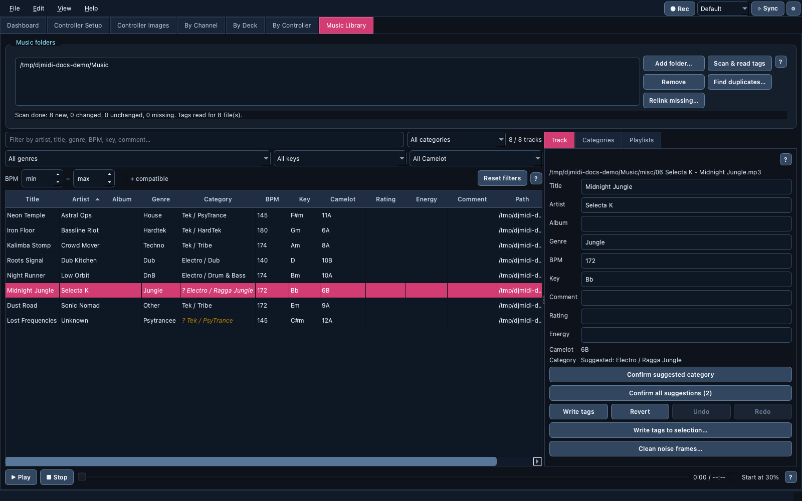
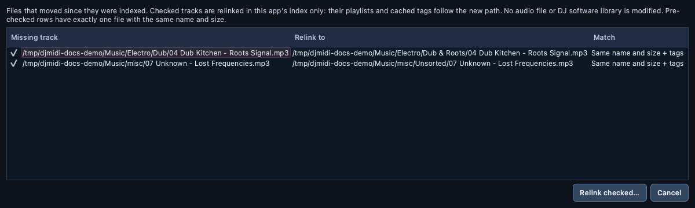
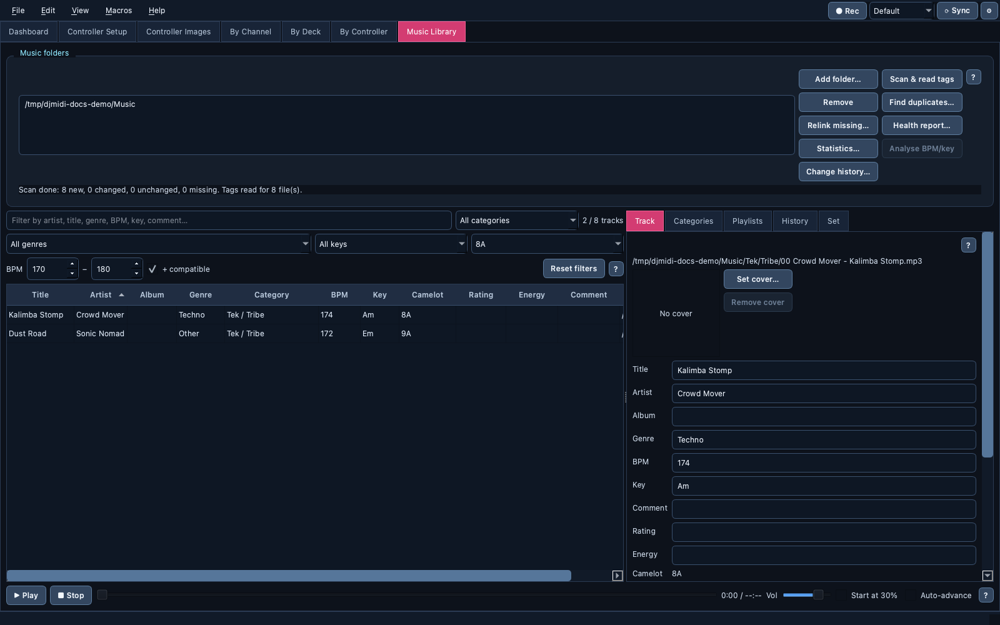
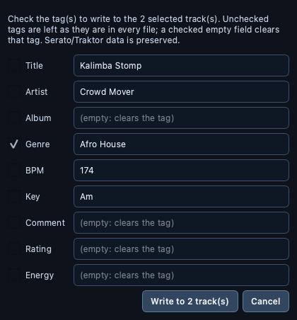
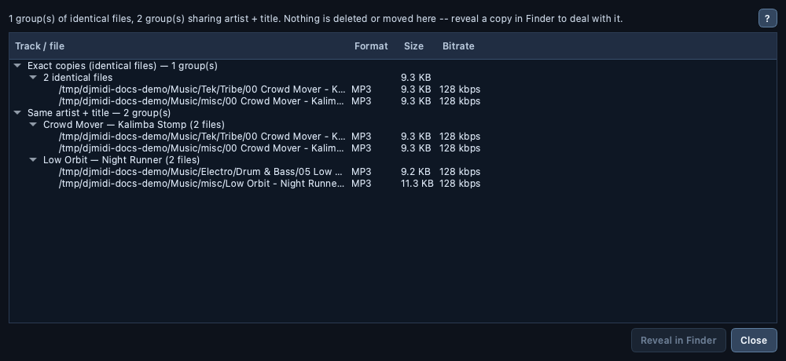
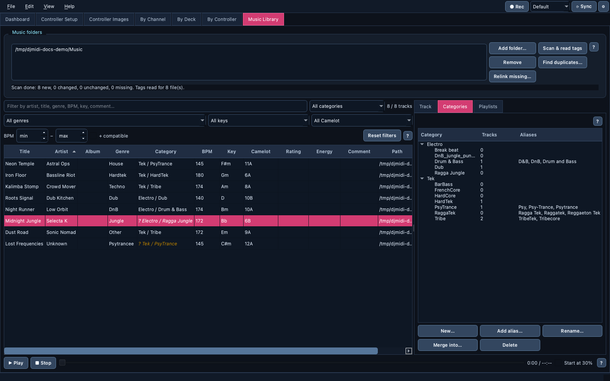
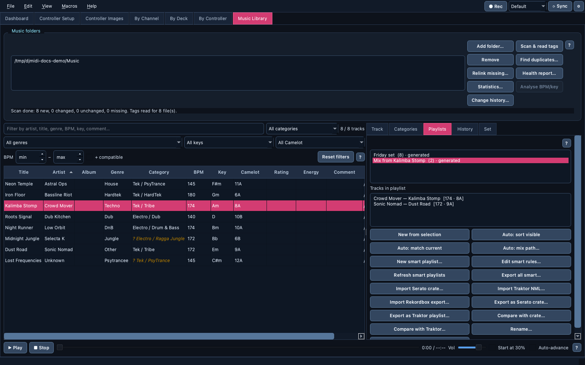

# 🎵 Music Library

> Get a messy collection mix-ready: scan your folders, fix tags in bulk,
> see every key on the Camelot wheel, sort tracks into genre categories, and
> build harmonic playlists you can export to Serato and Traktor.

📍 [Docs](../../README.md) › [End user](../README.md) › [Features](README.md) › Music Library

## Table of Contents

- [What it does](#what-it-does)
- [Scan your music](#scan-your-music)
- [Relink moved tracks](#relink-moved-tracks)
- [Browse, sort and filter](#browse-sort-and-filter)
- [Listen to a track](#listen-to-a-track)
- [Edit tags](#edit-tags)
- [Write tags to many tracks at once](#write-tags-to-many-tracks-at-once)
- [Estimate missing BPM and keys](#estimate-missing-bpm-and-keys)
- [Find duplicate tracks](#find-duplicate-tracks)
- [Check library health](#check-library-health)
- [Library statistics](#library-statistics)
- [Genre categories](#genre-categories)
- [Playlists](#playlists)
- [Prepare a set](#prepare-a-set)
- [Import and export with DJ software](#import-and-export-with-dj-software)
- [Compare with a Serato crate or Traktor playlist](#compare-with-a-serato-crate-or-traktor-playlist)
- [Play history](#play-history)
- [Safety: what is never touched](#safety-what-is-never-touched)
- [Related](#related)

## What it does

The `Music Library` tab manages your own tracks, independently of any MIDI
mapping. It is built for large collections (tens of thousands of files)
and stays responsive while it works.

## Scan your music

1. `Add folder…` and pick one or more music folders.
2. Click `Scan & read tags`. A progress bar runs; the window stays usable.

Later scans only re-read files that changed. A file that disappears, for
example on an unplugged drive, is greyed out as *missing* instead of being
forgotten. MP3, WAV, AIFF, FLAC, M4A, OGG and AAC files are indexed.

The index lives beside the preferences file as `library.sqlite3`; it
records file paths, sizes, dates and a cache of the tags, never the audio.

## Relink moved tracks

When you move or rename folders, the old paths show up as *missing* and the
files appear again under their new paths. `Relink missing…` finds where each
missing track went and lists it with its proposed new path:

- Rows with exactly one file of the **same name and size** are ticked
  already.
- Several possible files, a file with the same name but another size, or a
  differently named file whose title and artist tags match are listed but
  left unticked. Pick the right file in the `Relink to` list and tick it.
- `(not scanned yet)` means the file sits in one of your music folders but
  hasn't been scanned; relinking indexes it.

Click `Relink checked…` and confirm. Playlists that listed the old path now
use the new one, the cached tags follow, and the stale entry disappears.
Only this app's index changes: no audio file and no Serato, Traktor or
Rekordbox library is touched. Relinking can't be undone, so check the list
before confirming.

## Browse, sort and filter

- Click a column header to sort (BPM sorts numerically).
- Type in the search box to search titles, artists, genres, BPM, keys and
  comments.
- Narrow the list with the filters under it. They combine, and the
  `N / M tracks` counter shows how many tracks are left:

| Filter | Shows |
| --- | --- |
| Category | One category, or `Uncategorized` |
| Genre | Tracks with that genre tag (the list holds every genre in your library) |
| Key | Tracks with that key tag, as written in the file |
| Camelot | Tracks in that Camelot key; tick `+ compatible` to add the keys that mix harmonically with it (±1 on the wheel and the relative major/minor) |
| BPM `min` – `max` | Tracks within that range, both ends included; leave a side at `min` / `max` for no limit. Tracks without a BPM are hidden while a BPM limit is set |

`Reset filters` clears the search box and every filter. Filters stay as they
are after a rescan or a tag edit.

The **Camelot** column translates any key notation into the Camelot wheel
used for harmonic mixing: `Am`, `F#m`, Open Key `7m` and `8A` are all
understood.

## Listen to a track

The preview bar under the table plays the selected track, so you can check
a category or a key by ear without opening your DJ software:

- `▶ Play` / `❚❚ Pause` and `■ Stop` (stop rewinds to the start).
- Drag the slider to move through the track; the label shows position and
  length.
- While a track plays, selecting another one switches to it straight away —
  handy for auditioning a list with the arrow keys.
- Tick **Start at 30%** to skip the intro.
- **Vol** sets the preview volume; it is remembered for next time.
- With the track list focused, **Space** plays or pauses and **←** / **→**
  jump back or forward 10 seconds.
- Tick **Auto-advance** (off by default, remembered) to play the next track
  in the list when one ends; missing files are skipped.

Playback stops when you leave the tab or close the app. If your system
can't play audio through Qt, the bar stays greyed out with a tooltip
explaining why; files are only read, never changed.

## Edit tags

Select a track; the **Track** panel shows its title, artist, album, genre,
BPM, key, comment, rating and energy. Edit any field and click `Write tags`
(or press Enter). Only the changed fields are written to the file.

`Undo` / `Redo` write the previous values back. `Revert` discards edits you
haven't written yet. `Clean noise frames…` lists leftover junk tags (old
ID3v1 comment copies, old player preferences, ReplayGain values…) and
removes them only after you confirm.

## Write tags to many tracks at once

To give a whole album the same genre, or fix an artist name everywhere:

1. Select the tracks in the table (Shift-click for a range, Cmd/Ctrl-click
   to add tracks).
2. Optionally type the new values in the Track panel.
3. Click `Write tags to selection…`.
4. Tick the tag(s) to write. Each field starts with the Track panel's value,
   and the fields you just edited are already ticked. Unticked tags are left
   as they are in every file; a ticked empty field clears that tag.
5. Click `Write to N track(s)`.

Tracks that already have the value are skipped, the whole batch is a single
`Undo` step, and a file that can't be written is reported at the end
without stopping the others.

A long batch shows a progress window (`Writing tags… 312/850`), and so does
its `Undo`. `Cancel` stops after the current file: the files already written
keep their new tags, and `Undo` restores exactly those. The window stays
open until the table has been refreshed, so the app is ready as soon as it
closes.

## Estimate missing BPM and keys

Tracks with no BPM or key tag can't be filtered by tempo or matched on the
Camelot wheel. `Analyse BPM/key` listens to them and suggests the values:

1. Scan your folders first, so the tags are known.
2. Click `Analyse BPM/key`. Only tracks missing a BPM or a key are analysed
   (a minute from the middle of each track); the window stays usable, and
   the button turns into `Stop analysis` until it's done. Stopping keeps
   what was found so far.
3. Estimates appear in amber with a `?` in the BPM, Key and Camelot
   columns, and on the Track panel's `Analysis` line. They are **not** in
   your files yet.
4. Select the tracks whose estimates you trust and click
   `Apply analysis suggestions…`. The list is shown before anything is
   written; only empty BPM/key tags are filled, never one you already set.
   The whole batch is one `Undo` step.

Key estimates are right most of the time, but heavy bass can fool them:
listen before applying them to a set you care about. A track is analysed
once; it is looked at again only if the file changes outside this app.

The button is greyed out, with the reason in its tooltip, when the optional
audio-analysis component isn't installed (from a source checkout:
`uv sync --extra analysis`).

## Find duplicate tracks

Click `Find duplicates…` (next to `Scan & read tags`, after a scan). The
search runs in the background with a progress bar, then a **Duplicate
tracks** window lists two kinds of groups:

| Group | Meaning |
| --- | --- |
| Exact copies | Byte-identical files. Only files of exactly the same size are read and compared, so this stays quick on a large collection |
| Same artist + title | Tags that match once case, accents, punctuation, `feat.` credits and an `(Original Mix)` suffix are ignored. Other versions — `(Extended Mix)`, `(Radio Edit)`, remixes, `(Live)` — stay separate. These are candidates, not proof: compare them before acting |

Each file shows its path, format and size; expand a group to see each
file's bitrate. Select a file and click `Reveal in Finder` (or double-click
it) to see it in your file manager.

To clean up, tick the copies you don't want and click `Move ticked to
Trash…`:

- At least one copy of every group must stay: if you tick every file of a
  group, nothing is moved and the window tells you which group to fix.
- A confirmation lists each file to discard and the copy kept in its place.
- Files go to the system **Trash** — never deleted outright — so you can put
  them back from there. They show as missing in the library afterwards.
- If one of this app's playlists lists a discarded copy, you are asked
  whether to point it at the kept copy instead. Serato, Traktor and
  Rekordbox playlists are not changed: update those in your DJ software.

Track lengths are not compared yet.

## Check library health

Click `Health report…` (next to `Find duplicates…`, after a scan). Every
scanned file is opened once — only its header and tags, no audio is played
or decoded — with a progress bar, then a **Library health report** window
lists one row per problem:

| Issue | Meaning |
| --- | --- |
| Unreadable / corrupt | The file can't be parsed (damaged or truncated, or not really audio) or can't be opened. Nothing else is checked for it |
| Zero length | An empty (0-byte) file, or one whose stream lasts 0 seconds |
| Empty title / Empty artist | The tag is missing or blank |
| Missing artwork | No cover picture embedded in the file |
| Low bitrate | 128 kbps or less. Formats that don't report a bitrate are never flagged |

A file can appear on several rows, one per problem. Narrow the list with
the issue check boxes (each shows its count) and the filter box, which
matches the path and the detail. Click a column header to sort.

- `Show in library` (or a double-click) selects the track in the library
  table — clearing its filters if they hide it — so you can fix its tags in
  the Track panel.
- `Reveal in Finder` shows the file in your file manager.
- `Export CSV…` saves the rows currently shown (`path`, `issue`, `detail`)
  as a CSV file that opens in any spreadsheet app.

The report never changes a file. Run it again after fixing things to see
the updated list.

## Library statistics

Click `Statistics…` (next to `Health report…`, after a scan) to see your
collection as bar charts, one tab each:

| Tab | What it counts |
| --- | --- |
| Categories | Tracks per confirmed genre category; `Uncategorized` for the rest (an amber suggestion doesn't count until you confirm it) |
| Genres | Tracks per genre tag. Spellings that only differ by case or spaces (`Psy Trance`, `psy  trance`) count together |
| BPM | A histogram in 5 BPM steps, with the number of tracks without a BPM |
| Keys | The 24 Camelot keys in wheel order (1A, 1B … 12B), with the number of tracks without a key |
| Added per month | Files per month of their modification date — the closest thing to a "date added" the files carry. A tag edit makes a file count as recent |
| Most played | The 25 most-played tracks and how many were never played, once you've loaded your DJ history in the [History panel](#play-history) |

The statistics follow the table's filters: filter on a category, a BPM
range or a search first to chart just that part of the library (the line at
the top of the window says how many tracks are counted). Missing files are left out.
Hover a bar for its exact count; double-click a track in `Most played` to
select it in the table.

The window is a snapshot — reopen it after a scan, a filter change or
loading history. It never changes a file.

## Genre categories

Tracks are sorted into two-level categories, `Family / Name` (for example
`Tek / PsyTrance`), using your folder names and Serato crate names first,
then the genre tag, since a genre tag alone is often wrong.

- A category shown in amber as `? Tek / PsyTrance` is only a
  **suggestion** from a near-match spelling. Select the track and click
  `Confirm suggested category` to make that spelling a permanent alias.
  `Confirm all suggestions (N)` does it for every track shown in the table
  (narrow them with the filters first if you want), after listing each
  genre → category pair. Suggestions are never applied on their own.
- The **Categories** panel shows track counts and lets you create, rename,
  merge and delete categories and aliases (`DnB`, `D&B` and `Drum and Bass`
  can all mean `Drum & Bass`).

## Playlists

The **Playlists** panel:

| Button | Result |
| --- | --- |
| `New from selection` | A playlist of the selected rows |
| `Auto: sort visible` | Every visible row, grouped by category, then BPM range, then key |
| `Auto: match current` | The selected track followed by every visible track within ±6 % BPM and a harmonically compatible Camelot key |
| `Auto: mix path…` | The visible tracks chained into a set you can actually mix: each track is within the BPM tolerance (±6 % by default) and a compatible Camelot key of the one before, and the BPM rises, falls or stays steady. Starts from the selected track (else the slowest, or the fastest when falling); tracks that can't be chained — or come after the maximum length — go to a second `… (leftovers)` playlist |
| `Rename…` / `Delete` | Manage the selected playlist |

`Auto: mix path…` opens a small dialog first:

| Option | Meaning |
| --- | --- |
| BPM direction | Rising, falling, or steady (smallest moves, either way) |
| BPM tolerance | The largest BPM gap allowed between two consecutive tracks, from ±0.5 % to ±20 % (default ±6 %) |
| Maximum length | Stop the path after this many tracks (`No limit` by default); the rest go to the leftovers |

It only uses the tracks the current filter shows (the dialog says how
many) — clear the filters first to build from the whole library. Your last
choices are remembered with the library index, so the next path starts from
the same settings.

A rising or falling path never steps back, so it skips tracks to keep the
BPM moving one way — filter the table to one category first for the longest
paths, and check the leftovers playlist for what didn't fit.

## Prepare a set

The **Set** panel is a draft you order by hand, for when you want to choose
every track yourself and only need the app to check the mixes:

- Drag rows from the table into the list (or select them and click `Add
  selection`). Drop them where they should play; each track appears once.
- Drag tracks inside the list (or use `Move up` / `Move down`) to reorder.
  `Remove`, `Clear` and `Load playlist` (the one selected in the Playlists
  panel) edit the whole draft.
- The curve above the list shows the BPM (blue, left scale) and the energy
  (orange, 1–10, read from the `Energy` tag, e.g. Mixed In Key's) across the
  set.

Each transition is checked with the same rules as the automatic playlists:

| Look | Meaning |
| --- | --- |
| Red segment on the curve, `⚠` and red text in the list | The BPM jumps past your tolerance (`BPM tolerance ±`, 6 % by default), or the keys clash on the Camelot wheel. Hover the track for the reason |
| Dashed grey segment | A BPM or key is missing, so it can't be checked |
| Blue segment | Compatible |

Nothing is reordered for you, and the draft is remembered with the library
index until you change it. `Save as playlist…` stores it as an app playlist
(shown with the source `set` in the Playlists panel); `Export as Serato
crate…` and `Export as Traktor playlist…` write a new file where you choose,
exactly like the Playlists panel's exports.

## Import and export with DJ software

| Software | Import (read-only) | Export |
| --- | --- | --- |
| Serato | `Import Serato crate…` (`_Serato_/Subcrates/*.crate`) | `Export as Serato crate…` writes a new `.crate` where you choose; copy it into `_Serato_/Subcrates` yourself |
| Traktor | `Import Traktor NML…` (playlists of `collection.nml`) | `Export as Traktor playlist…` writes a new `.nml`; in Traktor, right-click `Playlists` → `Import Playlist` |
| Rekordbox | `Import Rekordbox export…` (USB `PIONEER/rekordbox/export.pdb`) | — |

Imported Serato crate names also help categorize tracks.

## Compare with a Serato crate or Traktor playlist

Select one of the app's playlists, then:

| Button | Compares it with |
| --- | --- |
| `Compare with crate…` | A Serato crate you pick (`_Serato_/Subcrates/*.crate`) |
| `Compare with Traktor…` | One playlist of a Traktor `.nml` you pick (`collection.nml`, or a single-playlist `.nml`); when the file holds several, you choose which — a playlist with the same name is preselected |

A window lists the differences in three tabs:

| Tab | Shows |
| --- | --- |
| `Only in app` | Tracks of the app playlist the other side doesn't list, with their position in the app playlist |
| `Only in …` | Tracks the crate or Traktor playlist lists but the app playlist doesn't, with their position there |
| `Order differences` | Tracks both sides list but in a different order, as `#app position → #other position` |

Order differences only list the tracks that are out of place compared with
the others: moving one track flags that one track, and a track missing on
one side never makes the rest look reordered.

Tracks are matched by their file path, so a track that was moved on disk, or
is listed through a different drive name, shows up on both sides. A track
listed twice is matched copy by copy.

Comparing is read-only: neither the app playlist nor the Serato or Traktor
file is changed. To bring the other side in line, use `Export as Serato
crate…` or `Export as Traktor playlist…`.

## Play history

The **History** panel shows what you actually played, read from your DJ
software's own history:

| Button | Result |
| --- | --- |
| `Load DJ history` | Reads Serato (`~/Music/_Serato_/History`) and Traktor (`~/Music/_Traktor/History`) when they exist |
| `Load from folder…` | Reads another Serato `History`/`Sessions` folder or Traktor `History` folder (on an external drive, say) |
| `Select never played` | Selects, in the table, every visible track no session played — ready for `New from selection` |

Each session is listed newest first with its date and track count; open it
to see each track's start time and deck. Double-click a track to select it
in the table. Grey rows were only loaded and not marked as played (Serato's
*played* checkbox off, or a Traktor track only pre-listened in the
headphones), or point at a file outside your indexed folders — for example
a session recorded on another computer. Only played rows count: a track
that was only ever loaded still counts as never played.

The summary line gives the totals: sessions, plays, distinct tracks, and
how many of your indexed tracks were never played. History files are only
ever read.

## Safety: what is never touched

- Tag writes change only the fields you edit. Serato and Traktor data stored
  inside your audio files (cue points, beat grids, analysis) is preserved.
- Serato, Traktor and Rekordbox library and history files are only ever read
  (imports and comparisons alike). Exports
  always create a new file at the location you choose.
- Undo writes the old values back through the same careful path.
- `Find duplicates…` only reads files. Copies you tick go to the Trash after
  a confirmation, never deleted outright, and one copy of each group always
  stays.
- `Health report…` only reads files.
- `Statistics…` only reads this app's index and the history you loaded.

## Related

- [Supported files](../user-guide.md#supported-files)
- [Mapping editor](mapping-editor.md)
