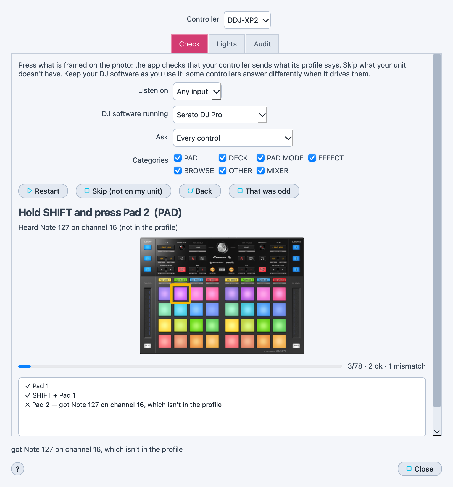

# ✅ Verify a controller profile

> ✅ Press what is framed on the photo, then say which lights answer: the
> app checks your controller against its profile, keeps what it learns as
> the controller's library, and gives you an audit and a report to share.

📍 [Docs](../../README.md) › [End user](../README.md) › [Features](README.md) › Verify a controller profile

## Table of Contents

- [Why](#why)
- [Run a check](#run-a-check)
- [Read the results](#read-the-results)
- [Check the lights](#check-the-lights)
- [The audit](#the-audit)
- [What the app keeps](#what-the-app-keeps)
- [Share the report](#share-the-report)
- [Related](#related)

## Why

Most controller profiles were transcribed from the vendor's MIDI
documentation, or built from rekordbox's mappings, and have never been
pressed on a real unit (`Not yet` in
[Supported controllers](../controller-profiles.md#built-in-controllers)).
Real units also surprise: a Pioneer DDJ-XP2 sends other notes for some
buttons, and has its pad modes 5–8 at all, only while Serato drives it.
A check on your own controller tells you — and everyone, if you share it —
what is really true.

## Run a check

1. Connect the controller, and keep your DJ software as you play with it
   (open or closed).
2. **`File` → `Controller Profile` → `Verify Profile with the Controller…`**,
   tab **`Check`**. The controller detected on your MIDI inputs is
   preselected; pick another one in **Controller** if needed.
3. Set **`DJ software running`** to what is running right now.
4. Untick the **`Categories`** you want to leave out (deck buttons, pads,
   effects…). In **`Ask`**, choose **`Every control`**, **`Only what isn't
   checked yet`** (to carry on another day) or **`Only mismatches and odd
   ones`** (to redo them).
5. Click **`Start`** and press what is **framed in yellow** on the photo —
   then `Hold SHIFT and press…` when the control has a SHIFT layer. The
   frame turns green when it matches, red when it doesn't.
6. **`Skip (not on my unit)`** for a control your controller doesn't have,
   **`Back`** to redo the previous one, **`That was odd`** to flag an answer
   you want to look at again.

Good to know:

- Any deck counts, and for a pad any pad mode: switching decks (SHIFT + a
  deck button, a double SHIFT…) never spoils the check. The line under the
  prompt says what the app heard (deck, pad mode, control).
- Holding SHIFT is never taken for the control asked; the app waits for the
  control itself.
- The app listens a moment after each press, so a control that sends two
  messages, a double press or a long press is judged on all of them.
- A control without a marker on the photo is not framed: the prompt names
  it.

The app listens through the [Live Monitor](live-monitor.md) (started for
you). While the window is open, the presses are only used for the check:
they don't fire [macros](midi-macros.md).

## Read the results

Each answer is listed as it comes:

- ✓ the control sends what the profile says;
- ✗ it sends something else — the line says what, and whether the profile
  gives that message to another control (two controls swapped) or doesn't
  know it at all (a wrong note number);
- ? flagged as odd;
- – skipped.

## Check the lights

Tab **`Lights`**. A button's light often answers another message than the
button sends, so the app never takes a light for granted:

1. Pick the controller's output in **`Send to`** and a **`Category`**.
2. **`Light the next one`**: the app lights one LED and frames the control
   it expects. Answer **`✓ It lit there`**, **`✗ Nothing lit`**, or pick the
   control that lit instead and click **`Another one lit`**.
3. **`▶ Play the light show`** lights the whole category in turn; answer
   **`Each one lit`** or **`Some didn't`**.

Each answer is recorded as verified LED data, which the
[Atelier](atelier.md) then uses.

## The audit

Tab **`Audit`**: every control of the controller with its message, its
status — verified, control verified (on another deck or pad mode),
mismatch, flagged as odd, not on the unit, never tested — what it was
captured with (per DJ software) and whether its LED is verified.
**`Copy audit`** and **`Save audit…`** give it as a Markdown table.

A mismatch with no DJ software running doesn't count against a control
verified while a DJ software drives it: profiles describe the controller as
you use it.

## What the app keeps

Everything stays in your workspace's `Controllers` folder, one file per
controller: what each control sent, under which DJ software, on which day
(`<controller>.captures.json`), and the lights you confirmed
(`<controller>.leds.json`). Together with the profile they are the
controller's library, which the other tools read: the **Feature** card of
the [Atelier](atelier.md) and of the Controller Emulator shows each
control's verdict and verified LED as soon as you answer. Nothing here ever
changes the profile itself.

## Share the report

**`Submit to the project…`** opens a pre-filled GitHub issue (label
`profile-check`) with the report in your browser; nothing is sent until you
submit it there. A long report is copied to the clipboard instead, to paste
into the issue. **`Copy report`** and **`Save report…`** (Markdown, in the
`Exports` folder by default) keep it for you. The report names the
controller, the app version, the input and the DJ software running — no
mapping or personal file is included.

## Related

- [Supported controllers](../controller-profiles.md): which profiles are verified.
- [Controller Setup](controller-setup.md): build or correct a profile.
- [Atelier](atelier.md): use the controller's features, lights included.
- [Live Monitor](live-monitor.md): watch raw MIDI from your controller.
