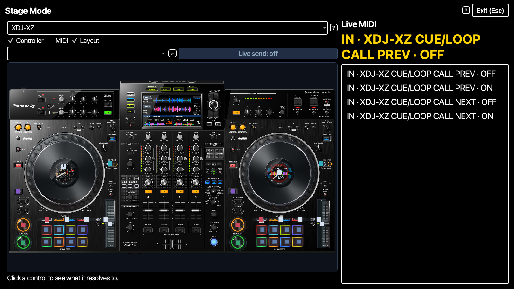

# 🎤 Stage Mode

> One full-screen, high-contrast view for playing live: a Controller
> Emulator and a compact Live Monitor, nothing else. Esc to leave.

📍 [Docs](../../README.md) › [End user](../README.md) › [Features](README.md) › Stage Mode

## Table of Contents

- [What it does](#what-it-does)
- [Open and leave Stage Mode](#open-and-leave-stage-mode)
- [The emulator](#the-emulator)
- [The compact monitor](#the-compact-monitor)
- [Related](#related)

## What it does

On stage the main window is too busy and too small to read from a step
away. Stage Mode opens a separate window that fills the screen with black
background, white text and large type, showing only what you need while
playing: your controller, lighting up as you touch it, and the last few MIDI
messages it sent.

## Open and leave Stage Mode

`View → Stage Mode` (or `Ctrl+Shift+F`, `⌘⇧F` on macOS) opens it. Press
**Esc**, click **Exit (Esc)**, or untick `View → Stage Mode` to go back to
the main window, which stays exactly as you left it.

Opening Stage Mode starts the [Live Monitor](live-monitor.md) on every MIDI
input if it isn't running yet, since the view is empty without live input.
Stage Mode is not remembered: it is off at every launch.

## The emulator

The left side is a regular [Controller Emulator](controller-emulator.md). It
starts on the controller of your first open emulator window, or else the one
shown in Controller Images; pick another in its list at any time. It follows
the hardware exactly like an emulator window: a hit flashes the control, a
held button stays amber, and Serato's LED messages latch it. Clicking a
control still shows what the loaded mapping does, and `Live send` still
works.

## The compact monitor

The right side shows the latest MIDI message in large yellow type and the
last few below it, newest first: direction (`IN` / `OUT`), the physical
control's name when the app knows it (for example
`XDJ-XZ CUE/LOOP CALL PREV`), otherwise the raw channel and number, and
`ON` / `OFF` for a button or the 0–127 value for a knob.

Jog-wheel turns are left out — they send dozens of messages a second and
would push every press off the list. The full, detailed log stays in the
Live Monitor window.

## Related

- [Controller Emulator](controller-emulator.md)
- [Live Monitor](live-monitor.md)
- [Workspace and preferences](workspace.md#performance-mode)
