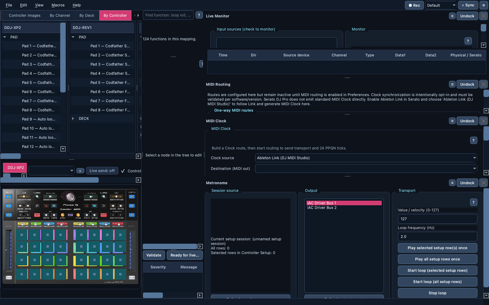
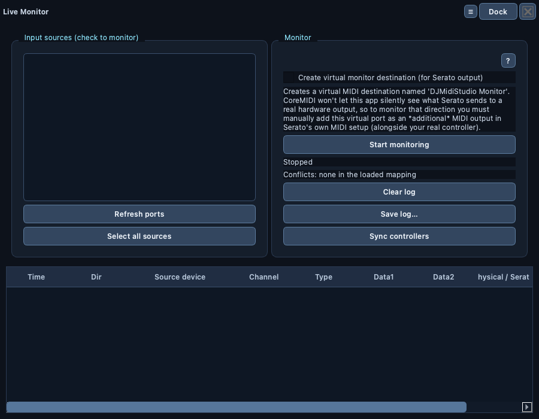

# 🪟 Workspace and preferences

> Arrange tabs and tool windows the way you play, switch to a stage-friendly
> view, and set the app's behavior in one Preferences dialog.

📍 [Docs](../../README.md) › [End user](../README.md) › [Features](README.md) › Workspace and preferences

## Table of Contents

- [Tabs and tool windows](#tabs-and-tool-windows)
- [Your files](#your-files)
- [Back up and restore](#back-up-and-restore)
- [Window controls](#window-controls)
- [Performance Mode](#performance-mode)
- [Preferences](#preferences)
- [Helpful Notes and Help](#helpful-notes-and-help)
- [New version notice](#new-version-notice)
- [Startup time](#startup-time)
- [Related](#related)

## Tabs and tool windows

The main window has tabs: `Dashboard`, `Controller Setup`, `Controller
Images`, `By Channel`, `By Deck`, `By Controller` and `Music Library`.

`Live Monitor`, `MIDI Routing`, `MIDI Clock`, `Metronome` and every
`Controller Emulator` are **tool windows**: open them from the `View` menu
(or the Dashboard), keep them docked beside the tabs, or float them as
separate windows. Window size, dock arrangement and each tool's settings
are restored at the next launch.





## Your files

Everything that is a file in the app is reachable from the **File** menu,
organized by what it is:

| Menu | What it handles |
| --- | --- |
| `Open Mapping…`, `Open Recent Mapping`, `Save Mapping`, `Save Mapping As…` | The Serato `.xml` or Traktor `.tsi` mapping you edit. It stays where your DJ software keeps it |
| `Restore Previous Version…`, `Show Mapping in Finder` | The version kept by your last save, and where the file is |
| `Compare Mapping With…`, `Compare With Previous Version` | What changed between the open mapping and another file or its `.bak` — see [Compare mappings](mapping-diff.md) |
| `Controller Profile ▸` | The controller profile you build in Controller Setup: new, open or save a draft, learn triggers from a mapping |
| `Import ▸` / `Export ▸` | Serato crates, Traktor playlists and Rekordbox exports for the Music Library, and the Live Monitor log |
| `Back Up Workspace…`, `Restore Workspace…` | Everything below plus your preferences, in one zip — see [Back up and restore](#back-up-and-restore) |
| `Import ▸` / `Export ▸` | Serato crates, Traktor playlists and Rekordbox exports for the Music Library, the Live Monitor log, and the [Cheat Sheet (PDF)](cheat-sheet.md) |

The Dashboard's **Your files** card, first on the row with *Known
controllers* and *MIDI tools*, shows the same things at a glance: the
open mapping and its folder, whether a previous version is kept, your recent
mappings, and your controller sync sets, with a button for each.

Everything the app creates for you lives in one folder you can see, back up
and share, `Documents/DJ MIDI Studio` (⚙ Preferences → `Open folder`):

| Folder | Holds |
| --- | --- |
| `Controllers` | Controller profiles you installed from Controller Setup |
| `Sync` | One initialization [sync set](controller-sync.md) per controller |
| `Macros` | Your [MIDI macros](midi-macros.md), one file each |
| `Drafts` | Controller Setup drafts you saved |
| `Logs` | Live Monitor logs you saved |
| `Exports` | Playlists exported from the Music Library, cheat sheets |

Your Serato and Traktor mappings are not moved there: they stay where your
DJ software keeps them, and the app only remembers where they are.

At launch the app **reopens your last mapping** — with the same DJ software,
without asking again — and the last Controller Setup draft you saved or
opened, so you pick up where you left off. Turn it off in ⚙ Preferences
(`Reopen my last mapping and Controller Setup draft at launch`).

## Back up and restore

`File → Back Up Workspace…` (or ⚙ Preferences → `Back up...`, next to your
files folder) saves, in one `.djmidi-backup.zip`:

- the whole `Documents/DJ MIDI Studio` folder — controller profiles, sync
  sets, drafts, logs and exports;
- your preferences;
- **optionally** the Music Library index — the app asks, showing its size.
  It lists your tracks, categories and playlists, never the audio files, and
  a fresh scan can rebuild it.

The backup is saved in `Exports` by default; earlier backups found there are
never put inside a new one. Your Serato and Traktor mappings are not part of
it — they stay with your DJ software (and every save keeps a previous
version next to them).

`File → Restore Workspace…` (or ⚙ Preferences → `Restore...`) opens a
backup — on another Mac too — and first tells you how many files it will add
and which existing ones it will **overwrite**, then waits for your
confirmation; if the backup holds a library index, a checkbox lets you
restore it too (ticked only when this Mac has none yet). Files you have that
aren't in the backup are kept. A file that isn't a DJ MIDI Studio backup, or
one whose paths would land outside your folders, is refused before anything
is written.

**Restart the app after a restore**: the restored preferences, controller
profiles and library are loaded at launch, so the app offers to quit right
away. Until you restart, saving preferences would overwrite the restored
ones.

## Window controls

Each tool window's title bar has:

- **Dock / Undock** to float it or put it back;
- a **Window** menu (the `☰` button): `Maximize` (again to restore), `Reduce to title bar`
  (again to expand), and `Snap left` / `Snap right` / `Snap to top` /
  `Snap to bottom`;
- **Close**.

On first launch the window is sized to your screen. Every tab scrolls
instead of squeezing its buttons when the window is small.

## Performance Mode

`View → Performance Mode` hides the trees of `By Channel`, `By Deck` and
`By Controller` and zooms their controller layouts, for a clean view on
stage. Turn it off to get your previous layout back exactly. It isn't kept
after a restart. For a full-screen view with just your controller and the
live MIDI, use [Stage Mode](stage-mode.md) instead.

`View → Show all controllers` temporarily shows every registered controller,
including the ones you disabled in Preferences.

## Preferences

The **⚙** button at the top right of the menu bar opens Preferences (the
**⟳ Sync** button beside it runs [Controller Sync](controller-sync.md)).

| Tab | Settings |
| --- | --- |
| General | Theme (`Follow system`, `Light`, `Dark`), integration detection (`Ask before enabling` or `Suggest detected integration`), log level and log file, `Enable MIDI routing policies`, `Trust external plugins`, `Auto-start Live Monitor when a mapping is loaded`, `Reopen my last mapping and Controller Setup draft at launch`, `Sync controllers at launch`, `Check for a new version at launch`, `Controller Setup default file`, your files folder (`Open folder`) |
| General | Theme (`Follow system`, `Light`, `Dark`), integration detection (`Ask before enabling` or `Suggest detected integration`), log level and log file, `Enable MIDI routing policies`, `Trust external plugins`, `Auto-start Live Monitor when a mapping is loaded`, `Reopen my last mapping and Controller Setup draft at launch`, `Controller Setup default file`, your files folder (`Open folder`, `Back up...`, `Restore...`) |
| Plugins | Enable or disable each controller and software plugin; `Enable all controllers` / `Disable all controllers` |
| Controller sync | Your [sync sets](controller-sync.md#manage-sync-sets) |

Safe defaults: detection asks before enabling anything, routing is off, and
external plugins are not trusted. Disabling a controller you don't own hides
it from every selector; it stays listed here to enable again. See
[Plugins](../plugins.md) for external plugins.

## Helpful Notes and Help

**Helpful Notes** opens at startup with quick tips; reopen it with
`View → Helpful Notes...`. When you close it you can choose not to see it
at startup again.

The **Help** menu opens this documentation, the bundled controller manuals
and the official online references, all offline except the latter.

Every tab and tool window also has **`?` buttons** next to the controls they
explain: click one for a short explanation of that area, and `Open full
guide` for its page of this documentation (bundled, so it works offline).

## New version notice

Once a day at most, a few seconds after launch, the app asks GitHub whether a
newer DJ MIDI Studio release exists. If there is one, the status bar shows
it, with an **Update available: vX.Y.Z** link on the right that opens the
release page in your browser. Nothing is ever downloaded or installed for
you: you get the new version from that page, when you choose.

The check runs in the background, so it never slows the app down, and it is
silent when you are offline or GitHub doesn't answer — handy at a gig with
no network. Turn it off in ⚙ Preferences → General (`Check for a new version
at launch`).

`Help → Check for Updates…` checks right away and always tells you the
result: a new version (with a button to open its page), up to date, or
GitHub couldn't be reached.

`Help → Report a Problem…` prepares a bug report you can read and edit
before it opens as a GitHub issue — see [Report a Problem](report-a-problem.md).

## Startup time

At each launch the execution log (set up in
[Preferences → General](#preferences)) records how long the app took to
show its window, with a breakdown per step:

```text
Startup: time to first window 740 ms -- imports 210 ms, preferences and logging 5 ms, Qt application 30 ms, main window built 470 ms, window shown 20 ms, first window 5 ms (total 740 ms)
```

To start faster, the app only does some work when you first need it: the
Dashboard loads each controller card's photo when you open that card, and
the `By…` and `Controller Images` tabs list your MIDI output ports (for
**Live send**) when you first open them. Include this line when you
[report](report-a-problem.md) a slow start.

## Related

- [Report a Problem](report-a-problem.md)
- [User guide](../user-guide.md)
- [Controller Sync](controller-sync.md)
- [MIDI Routing, Clock and Metronome](midi-routing-and-clock.md)
